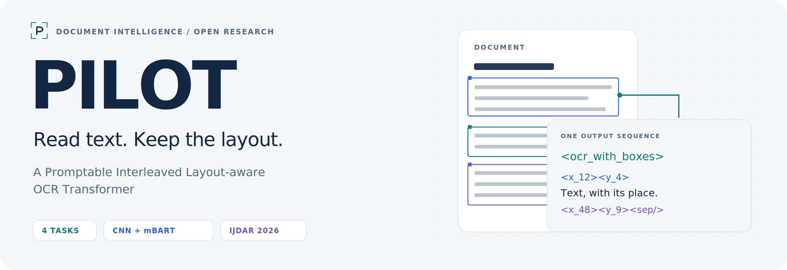
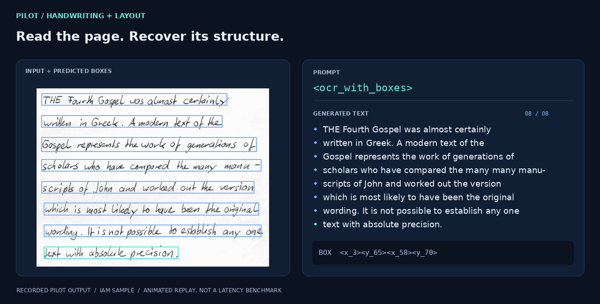
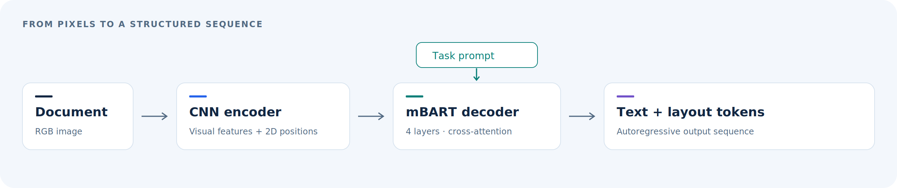

<picture>
  <source media="(prefers-color-scheme: dark)" srcset="assets/readme/hero-dark.png">
  <source media="(prefers-color-scheme: light)" srcset="assets/readme/hero-light.png">
  
</picture>

<p align="center">
  <a href="https://arxiv.org/abs/2504.03621"></a>
  <a href="https://doi.org/10.5281/zenodo.19681701"></a>
  <a href="LICENSE"></a>
</p>

<p align="center">
  <a href="#quickstart">Quickstart</a> ·
  <a href="#one-model-four-prompts">Tasks</a> ·
  <a href="#fine-tune-on-your-documents">Fine-tuning</a> ·
  <a href="docs/examples.md">Examples</a> ·
  <a href="#citation">Citation</a>
</p>

**PILOT** reads document images and generates **text and layout in one sequence**.
A CNN encoder and a four-layer mBART decoder provide a prompt-based interface for reading,
localizing and searching document content. The generic checkpoint supports all four tasks below;
specialized checkpoints target particular datasets and tasks.

This repository includes inference, released model configurations, fine-tuning code and two
complete training notebooks. The paper was accepted for publication in **IJDAR**.

## See the output



*Animated replay of the [recorded IAM prediction](outputs/iam_ocr_with_boxes.json), using
`pilot_iam`. Frame timing illustrates the sequence; it does not measure model latency.*
[Open the static version](assets/readme/demo-static.png) · [Browse all examples](docs/examples.md)

## One model, four prompts

<table>
  <tr>
    <td width="50%" valign="top">
      <h3>01 · Read</h3>
      <p><code>&lt;ocr&gt;</code></p>
      <p>Transcribe the document into text.</p>
    </td>
    <td width="50%" valign="top">
      <h3>02 · Localize</h3>
      <p><code>&lt;ocr_with_boxes&gt;</code></p>
      <p>Generate text together with its bounding boxes.</p>
    </td>
  </tr>
  <tr>
    <td width="50%" valign="top">
      <h3>03 · Search</h3>
      <p><code>&lt;find_it&gt; query</code></p>
      <p>Locate occurrences of a query string in the image.</p>
    </td>
    <td width="50%" valign="top">
      <h3>04 · Focus</h3>
      <p><code>&lt;ocr_on_box&gt; &lt;x_i&gt;&lt;y_j&gt;&lt;x_k&gt;&lt;y_l&gt;</code></p>
      <p>Read the content inside a specified region.</p>
    </td>
  </tr>
</table>

<picture>
  <source media="(prefers-color-scheme: dark)" srcset="assets/readme/architecture-dark.png">
  <source media="(prefers-color-scheme: light)" srcset="assets/readme/architecture-light.png">
  
</picture>

Visual features retain 2D spatial positions. The decoder attends to them while generating the
prompt-conditioned sequence. See the [paper](https://arxiv.org/abs/2504.03621) for the full architecture
and original training curriculum.

## Quickstart

### 1. Install

Use Python 3.10 or newer. Create and activate an environment:

```bash
git clone https://github.com/hamdilaziz/PILOT.git
cd PILOT
python -m venv .venv
source .venv/bin/activate
```

Install the appropriate [PyTorch build](https://pytorch.org/get-started/locally/) for your hardware
in that environment, then:

```bash
pip install -e .
```

The compatibility range is PyTorch 2.4+ and Transformers 4.57.x.
See [tested versions and validation limits](docs/performance.md).

### 2. Download a checkpoint

Download the **`.pt` weights and tokenizer** from [Zenodo](https://doi.org/10.5281/zenodo.19681701).
Place weights in `checkpoints/` and tokenizer files in `checkpoints/tokenizer/`.
Keep the configuration and tokenizer that belong to the selected weights.

<details>
<summary><b>Which checkpoint should I use?</b></summary>

| Configuration | Intended use | Tasks |
| --- | --- | --- |
| [pilot_generic](configs/pilot_generic.json) | General document OCR | All four prompts |
| [pilot_iam](configs/pilot_iam.json) | IAM handwriting | OCR with boxes |
| [pilot_iam_spotting](configs/pilot_iam_spotting.json) | IAM word spotting | Query localization |
| [pilot_rimes](configs/pilot_rimes.json) | RIMES handwriting | OCR with boxes |
| [pilot_sroie](configs/pilot_sroie.json) | SROIE receipts | OCR with boxes |

Configs define checkpoint paths, image statistics, coordinate bin size and decoder capacity.
If your weight filename differs, edit `checkpoint` or pass `--checkpoint path/to/model.pt`.

</details>

### 3. Run a prediction

```bash
python run_pilot.py --config configs/pilot_generic.json --image input_samples/other1.png --task ocr_with_boxes
```

Results are written to `outputs/`: raw sequence, cleaned text, JSON and predicted-box visualizations
where applicable. Add `--cpu` for CPU inference.

<details>
<summary><b>Search a word or read a region</b></summary>

```bash
python run_pilot.py --config configs/pilot_iam_spotting.json --image input_samples/iam-spotting.png --task find_it --query "accidentally"
python run_pilot.py --config configs/pilot_generic.json --image input_samples/focus_en_bench.png --task ocr_on_box --box 50 836 737 851
```

`--box` uses coordinates in the original image's pixels. The model config sets the coordinate bin size.
`python run_pilot.py --help` lists the available options.

</details>

## Fine-tune on your documents

Start with a released checkpoint and adapt it to new text, layouts or tagged extraction fields.
Both notebooks include **cached preparation → training → held-out prediction → CPU optimization**.

| Field extraction | OCR recognition |
| --- | --- |
| **[FATURA notebook](examples/finetune_fatura.ipynb)** | **[HierText notebook](examples/finetune_hiertext_ocr.ipynb)** |
| Extract six invoice fields using paired tags. | Recognize text from ground-truth line crops. |
| Select the checkpoint by generated **field micro F1**. | Select the checkpoint by generated **CER**. |

```bash
pip install -e ".[notebooks]"
jupyter lab
```

The notebook settings are **examples, not tuned hyperparameters**. The small subsets check the
workflow; resolution, annotation quality and sufficient data diversity determine actual performance.
Validation uses generated task metrics without computing a validation loss. Weights are saved as `.pt`.
Read the [notebook guide](docs/notebooks.md) for dataset protocols and the
[training guide](docs/training.md) for target formats, data volume and loss-design considerations.

<details>
<summary><b>Prefer a script and your own JSONL dataset?</b></summary>

Each record supplies an image path, prompt and target. Paths are relative to the JSONL file.

```json
{"image": "images/page_001.png", "prompt": "<ocr>", "target": "Text visible on the page."}
```

Edit `configs/train_custom.json`, then run:

```bash
python train_pilot.py --config configs/train_custom.json
python train_pilot.py --config configs/train_custom.json --resume
```

The trainer provides prompt masking, gradient accumulation, CUDA mixed precision, optional decoder
activation checkpointing, tokenizer extension and resumable epoch checkpoints.
The best model is exported with its exact tokenizer and inference config.

</details>

## Explore further

| Resource | What you will find |
| --- | --- |
| [Inference examples](docs/examples.md) | Commands, source images and recorded predictions |
| [Training guide](docs/training.md) | Data format, new tokens, metrics, checkpoints and recovery |
| [Notebook guide](docs/notebooks.md) | FATURA/HierText preparation, splits and evaluation definitions |
| [Performance guide](docs/performance.md) | Compatibility, CPU options and benchmarking scope |
| [Contributing](CONTRIBUTING.md) | Development setup and checks |

Questions and reproducible issues are welcome in [GitHub Issues](https://github.com/hamdilaziz/PILOT/issues).

## Citation

If PILOT supports your research, please cite the paper:

```bibtex
@article{hamdi2026pilot,
  title   = {PILOT: A Promptable Interleaved Layout-aware OCR Transformer},
  author  = {Hamdi, Laziz and Tamasna, Amine and Boisson, Pascal and Paquet, Thierry},
  journal = {International Journal on Document Analysis and Recognition},
  year    = {2026},
  note    = {Accepted for publication}
}
```

Released weights: [10.5281/zenodo.19681701](https://doi.org/10.5281/zenodo.19681701).
Code license: [Apache 2.0](LICENSE).
